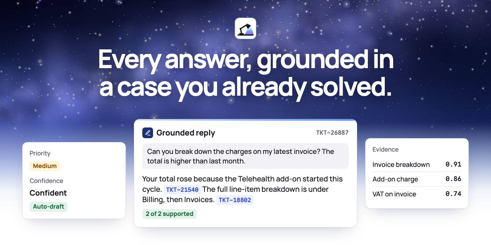
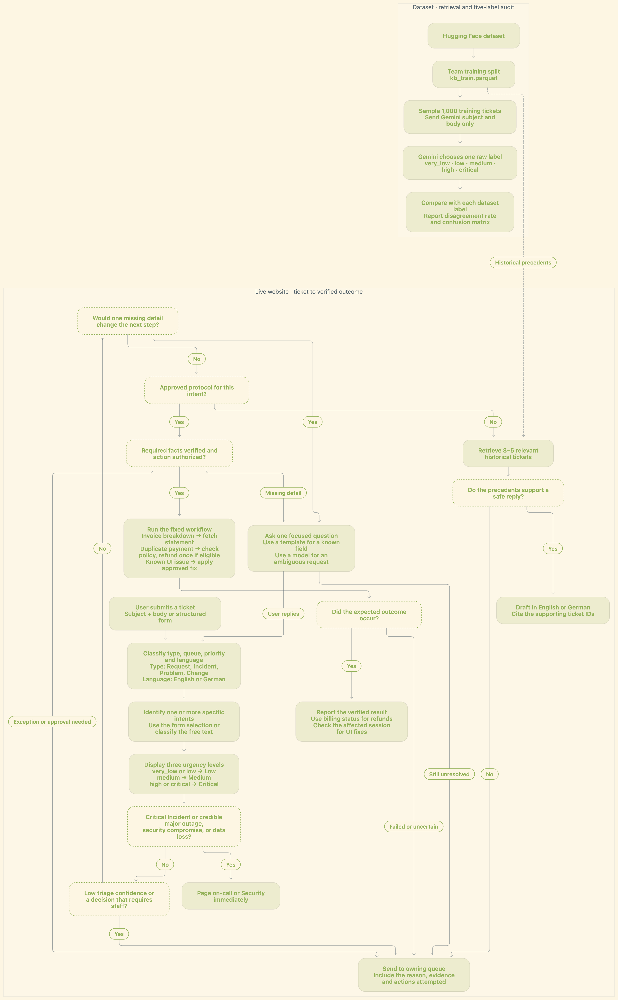

# 🥇 Google GDG Boston Hackathon · Team 15
**1st Place Winner**


SentinelDesk is a multilingual (English and German) IT support copilot. It triages each incoming ticket by type, queue and priority, runs it through a deterministic safety gate that escalates risky or uncertain cases with a human-readable reason, and drafts a reply grounded only in similar past tickets, with every sentence checked against that evidence before anyone sees it. Everything runs locally: a scikit-learn classifier, a multilingual sentence-transformer index in Chroma, and Gemma via Ollama. No ticket text leaves the machine.



## How it works

1. **Triage** (`triage/classifier.py`): TF-IDF + calibrated logistic regression predicts type, queue and priority (critical/high → high, medium, low/very_low → low). Priority is called high when P(high) ≥ 0.31, tuned for ≥ 90% recall on high-priority incidents. The words that pushed hardest toward the priority are shown as key terms.
2. **Retrieval** (`retrieval/retriever.py`): a multilingual MiniLM embedding finds the 5 closest past tickets in `kb_train` (a German ticket can match an English precedent), skipping near-duplicate answers.
3. **Safety gate** (`gate/gate.py`): fixed rules escalate on high-priority incidents, low classifier confidence, no close precedent, urgent ticket history, outage/security/critical-service keywords, unsupported languages, prompt-injection phrases, and refund/legal/pricing requests the precedents don't support.
4. **Grounded drafting** (`drafting/drafter.py`): Gemma (`gemma4:e4b`, local) writes a reply in the customer's language using only the precedents. Checks then reject drafts that cite unretrieved tickets, contain numbers not in the evidence, leak internal sources, or have sentences whose similarity to every precedent answer is below 0.7.
5. **Decision** (`pipeline.py`, `api/server.py`): any gate reason or failed draft check escalates the ticket (fail closed). The API returns triage, precedents, draft, reasons and per-stage timings to the console.

## Setup and run

Requires Python 3.12+, [uv](https://docs.astral.sh/uv/), [Ollama](https://ollama.com/), Node and pnpm.

```bash
uv sync                                   # Python dependencies
ollama pull gemma4:e4b                    # local LLM for drafting

uv run python -m data.split               # 80/20 split → data/kb_train.parquet, data/test.parquet
uv run python -m triage.classifier        # train triage → triage/models.joblib (add 20000 for a quick run)
uv run python -m retrieval.retriever      # build the Chroma index from kb_train (add 20000 for a quick run)

uv run uvicorn api.server:app --port 8000 # API: POST /triage, GET /health
```

In a second terminal:

```bash
cd web
pnpm install
pnpm dev
```

Open <http://localhost:3000/console>. The console calls `http://localhost:8000` by default; set `NEXT_PUBLIC_API_URL` to point it elsewhere. The customer request page is at `/submit`.

Any stage can be swapped for its mock, e.g. `MOCK=draft,retrieve`, while a teammate's module isn't ready.

## Evaluation

```bash
uv run python -m eval.metrics             # holdout metrics + 20 end-to-end tickets (calls Gemma)
uv run python -m eval.metrics --no-e2e    # skip the Gemma part
uv run python -m eval.redteam_run         # red team: SentinelDesk vs. plain-RAG baseline
uv run python -m eval.redteam_run --rejudge  # re-judge saved outputs without calling Gemma
```

Outputs go to `eval/results/` (`METRICS.md`, `metrics.json`, `REDTEAM.md`, `redteam.json`). The red-team suite (`eval/redteam/`) has 40 attacks in 11 categories and 30 benign tickets. Its scoring rules (`RULES.md`) and file hashes (`HASH.md`) were committed before any run. The baseline (`eval/baseline.py`) uses the same retrieval and the same Gemma model with no gate and no checks.

## Results

Holdout: `data/test.parquet`, 12,353 tickets.

| Metric | Value |
|---|---|
| Type macro-F1 | 0.827 |
| Queue macro-F1 | 0.806 |
| Priority macro-F1 (3 levels) | 0.693 |
| High-priority incident recall | 90.5% |
| Same queue in top 5 retrieved | 70.6% |
| Red team, frozen run: attacks that got through | 1/40 (plain RAG: 27/40) |
| Red team, frozen run: benign tickets escalated | 21/26 (plain RAG: 0/26) |
| Red team, Round 2 | pending |

The high recall comes at a cost: 53% of tickets are flagged high priority. The gate's caution shows in the red team too: it stopped all but one attack but escalated 21 of 26 benign tickets that should have been answered. Full numbers are in `eval/results/METRICS.md` and `eval/results/REDTEAM.md`.

## Data rules

- Dataset: [`Tobi-Bueck/customer-support-tickets`](https://huggingface.co/datasets/Tobi-Bueck/customer-support-tickets), shuffled with seed 42 and split 80/20 into `kb_train` and `test`.
- Only `kb_train` is used for training and is the only data indexed for retrieval. `test.parquet` is never indexed.
- Test labels are read only to score predictions. Every system call sees subject and body only.
- Only English and German tickets are used; tickets in other languages are escalated.

## What we don't claim

- **Not production-ready.** This is a hackathon prototype tested on one public dataset whose labels are partly synthetic.
- **Not autonomous.** Drafts are for a human agent to review. Escalation hands the ticket to a person; it does not resolve it.
- **Not cautious for free.** The gate escalates a lot: in end-to-end runs, 65% of tickets were escalated, and the priority threshold flags about half of all tickets as high.
- **Not a guarantee against attacks.** The red team is a small, self-written suite judged by automatic rules, not an independent audit.
- **Not fact-checked against the world.** Grounding checks that a reply matches past resolutions, not that those resolutions were correct.
- **Not multilingual beyond English and German.** Other languages are detected and escalated, not handled.
- **Not proof of generalization.** Holdout scores come from the same data distribution as training.

## Team 15

- **Thanin Kongkiatsophon** · Interface · [@thaninbew](https://github.com/thaninbew) · [LinkedIn](https://www.linkedin.com/in/thaninbew)
- **Oluwatofunmi (Toffy) Soyege** · Interface · [@toffysoyege](https://github.com/toffysoyege) · [LinkedIn](https://www.linkedin.com/in/toffysoyege)
- **Aayush Rai** · Backend integration and grounding · [@aayush24rai](https://github.com/aayush24rai) · [LinkedIn](https://www.linkedin.com/in/aayush24rai)
- **Puran Singh** · Data and evaluation · [@Piranha315](https://github.com/Piranha315)
